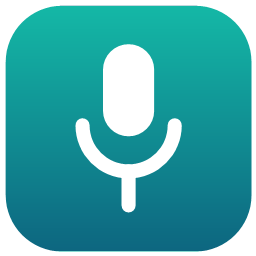
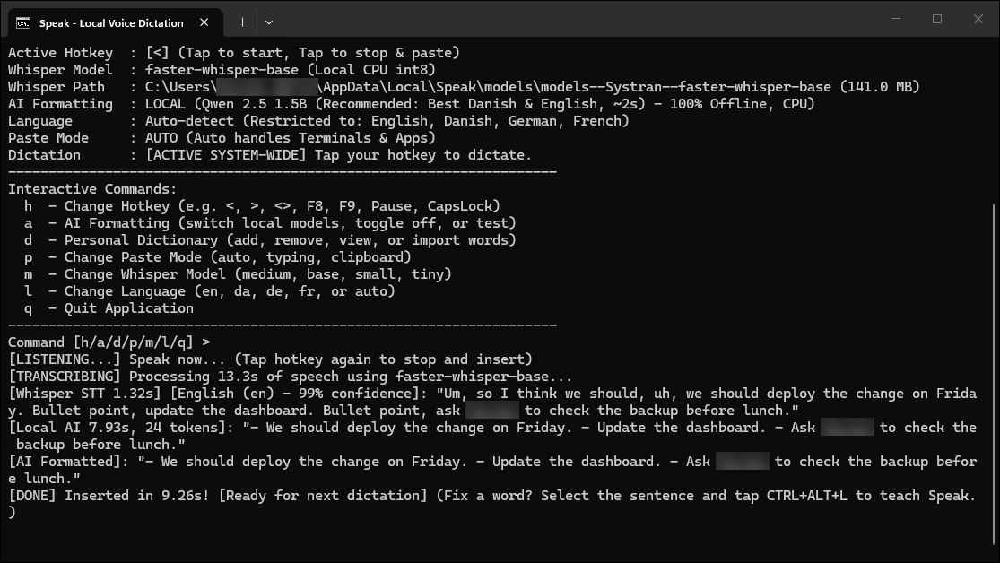
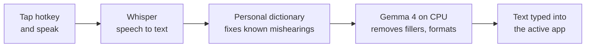
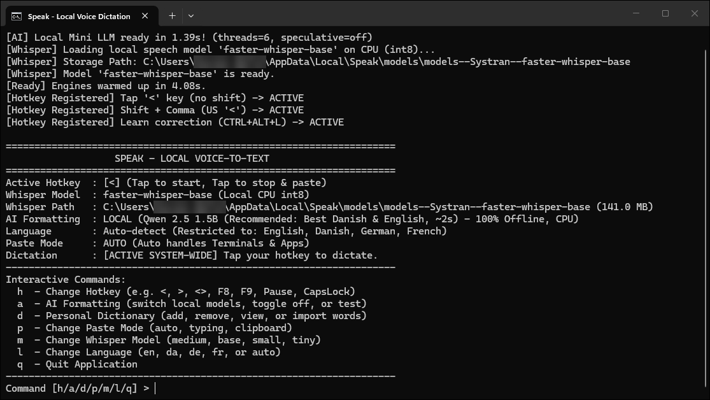
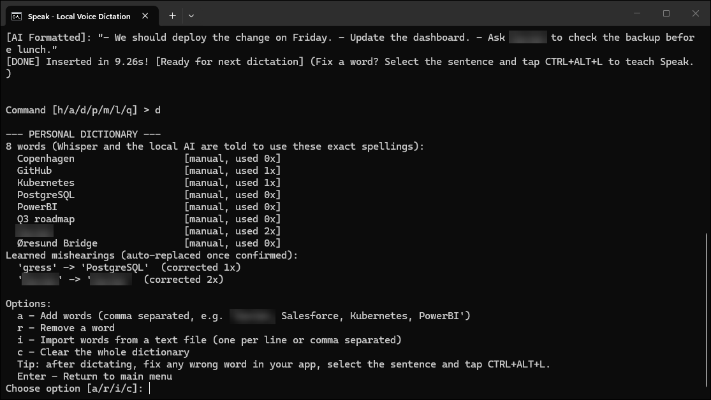

<div align="center">



# Speak

**Private, offline voice dictation for Windows. Tap a key, talk, and clean text appears wherever your cursor is.**




</div>

Speak listens when you tap a hotkey, transcribes your voice with [Whisper](https://github.com/SYSTRAN/faster-whisper), cleans up the "um"s and false starts with a small local language model ([Gemma 4 E2B](https://huggingface.co/google/gemma-4-E2B-it), or [Qwen3 1.7B](https://huggingface.co/Qwen/Qwen3-1.7B) if you prefer a smaller one), and types the result into the app you are using: Word, Outlook, Teams, a browser, a terminal, anything.

Everything runs on your own CPU. No audio or text leaves your computer, there is no account, and you do not need administrator rights.

---

## Features

- **100% offline and private.** Audio and transcripts never leave your computer. Nothing is sent to a server.
- **Works in any app.** Text is pasted or typed into whichever window has focus. Terminals and legacy apps that reject Ctrl+V get direct typing instead.
- **Cleans up how people actually talk.** Removes fillers (*um, uh, øh, altså, äh, euh*), fixes stutters and false starts, and turns spoken commands like *"bullet point"* and *"new line"* into real formatting.
- **Multilingual.** English, Danish, German and French, auto-detected or locked to one language.
- **Learns your words.** Add names, products and jargon to a personal dictionary. If Speak mishears a word, fix it in your document, select the sentence, press **Ctrl+Alt+L**, and Speak remembers the correction.
- **Meeting transcripts.** Press **Ctrl+Alt+M** to record a Teams, Zoom or in-room meeting. Speak writes a transcript that shows who said what (*Me*, *Person 1*, *Person 2*...), with a summary and action items. Also offline.
- **Tap or hold.** Tap the hotkey to start and again to stop, or switch on *hold to talk* and speak while you hold it. Speak can also stop by itself after a few seconds of silence.
- **Always visible.** An icon in the notification area shows whether Speak is ready, listening, writing or recording a meeting, with a menu to start, stop or quit.
- **No admin rights.** Runs entirely in Windows user space, with no services, drivers or firewall prompts.
- **Fast on a laptop CPU.** Short phrases appear in about 1 second, and longer dictations in about 2 to 3 seconds.

## How it works



Short, clean phrases such as *"Yes, that sounds good."* skip the language model entirely, so they appear almost instantly.

## Screenshots

| Ready to dictate | Personal dictionary |
| :---: | :---: |
|  |  |

## Install

### The easy way (no technical knowledge needed)

1. Press the **Start** button, type **PowerShell**, and open it.
2. Copy this line, paste it into the blue window (right-click pastes), and press **Enter**:

   ```powershell
   irm https://raw.githubusercontent.com/xav-art/Speak/main/install.ps1 | iex
   ```

3. Wait 5 to 15 minutes. The installer explains each step, and Speak starts by itself when it is done.

From then on, start Speak from the **Speak** icon on your Desktop or in the Start Menu. To update, run the same line again: your settings, dictionary and models are kept.

What the installer does, all inside your user account and without admin rights:

- Installs Python 3.12 for your user if you do not have Python 3.10 to 3.13 (with `winget`, or the signed installer from python.org).
- Puts Speak in `%LOCALAPPDATA%\Speak` with its own private Python environment, so it does not change anything else on your PC.
- Downloads the speech model and the AI model once (about 3.3 GB) and checks the AI model's SHA-256 checksum.
- Adds **Speak** and **Uninstall Speak** to the Start Menu, a Desktop icon, and the `speak` command for terminals.

No `.exe` is downloaded or run apart from Python's own signed installer, so antivirus and SmartScreen have nothing to flag. You can read [install.ps1](install.ps1) before you run it.

### From a ZIP file

1. Click the green **Code** button on this page and choose **Download ZIP**.
2. Extract the ZIP to the folder where you want Speak to live, for example `Documents\Speak`.
3. Double-click **setup.cmd**. If Windows asks whether to run a downloaded file, click **Run**: this happens only once, because setup removes the download mark from Speak's files.

### Uninstall

Open the Start Menu and choose **Uninstall Speak**. It asks whether to keep your personal dictionary and settings.

### Requirements

- Windows 10 or 11 (64-bit)
- A microphone
- About 4 GB of free disk space and 8 GB of RAM or more: the AI model uses about 2.5 GB, and about 5 GB while it writes a meeting summary (with `qwen3-1.7b`: 1.1 GB less disk and 0.8 GB less RAM). Meeting mode needs about 0.6 GB more disk, downloaded the first time you use it
- Internet access during setup only (and once, the first time you record a meeting)

### For developers

```powershell
git clone https://github.com/xav-art/Speak.git
cd Speak
python -m venv .venv
.venv\Scripts\python -m pip install --only-binary :all: --no-deps --index-url https://abetlen.github.io/llama-cpp-python/whl/cpu llama-cpp-python
.venv\Scripts\python -m pip install -r requirements.txt
.venv\Scripts\python -X utf8 speak.py
```

`llama-cpp-python` comes from its project's prebuilt CPU wheel index because PyPI only has the source, which needs a C++ compiler. Missing models download automatically on first start. You can also run `setup.cmd` in your clone to do all of this in place.

## Usage

Start Speak from its Desktop or Start Menu icon, or double-click `start_speak.bat`. Keep its window open while you work; you can minimize it.

1. Click where you want to write: an email, a document, a chat box.
2. Tap **`<`** (the key next to Left Shift) and speak.
3. Tap **`<`** again. The cleaned text appears at your cursor.

### Keyboard controls

| Key | What it does |
| :--- | :--- |
| **`<`** | Start recording. Tap again to stop and insert the text. |
| **`Ctrl+Alt+L`** | Learn a correction: after fixing a misheard word, select the sentence and press this. |
| **`Ctrl+Alt+M`** | Start recording a meeting. Press again to stop; the transcript is written in the background. |

Type these in the Speak window:

| Command | What it does |
| :--- | :--- |
| `h` | Change the hotkey (`<`, `>`, `<>`, `F8`, `F9`, `Pause`, `CapsLock`, ...) |
| `a` | AI cleanup: switch between Gemma 4 E2B and Qwen3 1.7B, turn it off, or run a test |
| `d` | Personal dictionary: list, add, remove or import words |
| `l` | Language: auto-detect, or lock to English, Danish, German or French |
| `m` | Whisper model: `base` (fast) or `medium` (more accurate) |
| `p` | Paste mode: `auto`, `typing` or `clipboard` |
| `r` | Meetings: start or stop a recording, record your voice sample, transcribe an audio or video file |
| `q` | Quit |

Command-line options: `--hotkey`, `--model`, `--language`, `--paste-mode`, `--ai-mode`. Run `speak --help` for details.

### Spoken commands

Say these while you dictate, after a short pause:

| Say | Danish | German | French | Result |
| :--- | :--- | :--- | :--- | :--- |
| *new line* | *ny linje* | *neue Zeile* | *à la ligne*, *nouvelle ligne* | Line break |
| *new paragraph*, *next paragraph* | *nyt afsnit* | *neuer Absatz* | *nouveau paragraphe* | Empty line |
| *bullet point* | *punkt* | *Aufzählungspunkt* | *puce* | New line starting with `- ` |
| *scratch that*, *delete that* (as a sentence of its own) | *slet det* | *streich das* | *efface ça* | Deletes the sentence before it |
| *no wait*, *sorry* | *nej vent* | *nein warte* | *non attends* | Keeps only the correction: *"on Tuesday, no wait, Wednesday"* becomes *"on Wednesday"* |

*New line*, *bullet point* and *scratch that* work only as commands: *"our new line of candles"* stays as it is. Speak applies those itself when Whisper wrote a pause (a comma or full stop) before them, and *punkt* or *puce* when it starts a sentence (*"Punkt opdater prislisten."*, but not *"Punkt 3 er vigtigt."*). Otherwise, and for the corrections, the AI step does it. With AI cleanup turned off (`a`, then `3`), Speak inserts exactly what Whisper heard.

## Personal dictionary

Speak keeps your word list in `speak_dictionary.json`, next to `speak.py`. It never leaves your PC.

| Method | How |
| :--- | :--- |
| **Auto-learn** (recommended) | Dictate. If a word came out wrong (*"Anika"* instead of *"Annika"*), correct it in your app, select the corrected sentence and press **Ctrl+Alt+L**. You hear a beep, and the console shows `[Learned] 'Anika' -> 'Annika'`. |
| **Manual** | Type `d` in the Speak window, then `a`, and enter words separated by commas. You can also import a text file. |

What Speak does with your words:

1. **Whisper is primed** with your dictionary before every dictation, so it hears the right spelling in the first place.
2. **Learned mishearings are corrected automatically** once they are confirmed: when the same context appears again, or after three corrections. Until then the AI cleanup gets a one-line hint.
3. **Exact casing is enforced** for multi-word and unusually cased entries (`øresund bridge` becomes `Øresund Bridge`, `sap` becomes `SAP`). An entry written all in lowercase (`excel`) never removes the capital at the start of a sentence.

A dictionary word in a short phrase does not slow it down: the AI step only runs for it when there is something only the AI can fix (a mishearing that is not confirmed yet, or a name such as *mette* that needs its capital).

Add the words Whisper gets wrong (names, products, jargon), not everyday words. Every entry nudges Whisper towards hearing it, and a capitalized everyday word (*Service*) gets capitalized in the middle of sentences.

Auto-learn ignores rewrites (more than half the words changed), everyday words, and anything shorter than three letters.

## Meetings

Speak can record a meeting and write a transcript that shows who said what:

```markdown
**[00:00:31] Me:** Okay, so the photos and the discount bug are the two blockers. Can you chase the studio today?
**[00:00:40] Person 1:** Yes, I will call them after this meeting and send an update before lunch.
**[00:00:46] Person 2:** Hej alle sammen. Har vi nok varer i Aarhus til lanceringen?
```

1. **Once:** type `r`, then `2`, and talk for 30 seconds. Speak stores a voice fingerprint (numbers, not audio) so it can label you as **Me**.
2. Press **Ctrl+Alt+M** when the meeting starts. Tell the other participants that you are recording.
3. Press **Ctrl+Alt+M** again when it ends. Speak transcribes in the background while you keep working (dictation still works), beeps, and saves the transcript to `C:\Users\<you>\Documents\Speak Meetings`. This is the local Documents folder on purpose: if Windows syncs your Documents to OneDrive, transcripts still stay on this PC.

It works for Teams, Zoom and Meet calls, in-room meetings around your laptop, and a mix of both. Speak records two things side by side: your microphone (you and anyone in the room) and your computer's sound output (everyone in the call). It never joins or connects to the call.

The transcript file has the date, length and speakers at the top, then a **summary**, **decisions** and **action items**, then the full transcript. Rename speakers with find and replace (`Person 1` to `Anna`). You can also transcribe an existing audio or video file: type `r`, then `3`.

How it works:

- **Devices that come and go:** if your headset drops out, switches profile or is plugged in during the meeting, Speak keeps recording. It reopens the microphone and the call audio, follows the call when Windows moves the sound to other speakers, and fills the missed seconds with silence, so both recordings stay lined up. The transcript notes when a device was out for 3 seconds or more, since what was said then may be missing.
- **Clock drift:** the microphone and the call audio run on different hardware clocks, which drift apart by up to a second an hour. Speak measures this during the recording and lines them up again before transcribing, so long meetings keep the right speaker order and echo removal.
- **Who spoke when:** [sherpa-onnx](https://github.com/k2-fsa/sherpa-onnx) speaker diarization (pyannote segmentation and NeMo TitaNet speaker embeddings, about 47 MB, no PyTorch). Speakers that match your voice sample become *Me*, everyone else *Person 1*, *Person 2* and so on, numbered in order of appearance.
- **What was said:** Whisper `small` (more accurate on long, mixed audio than the dictation model). Each speaker's language is detected separately, so a Danish colleague stays Danish in an English meeting.
- **Cleanup:** only turns with fillers or stutters go to the AI model, which may remove only those. Spoken commands are not applied in meetings. If the model drops or changes a word anyway, the turn is kept as spoken.
- **Decisions and action items:** Speak finds the sentences where someone promises something (*"I will"*, *"jeg vil"*, *"jeg tjekker det"*, *"leave it with me"*; but not a habit such as *"jeg tjekker altid mails"* or a refusal such as *"det gør jeg ikke"*), asks for something (*"can you"*, *"kan du"*) or agrees on something (*"let us"*, *"lad os"*). The AI model then rewrites each one as a short to-do with its deadline. The owner comes from the transcript, not from the AI: whoever made the promise, or whoever said yes to a request. A request nobody agreed to is listed with who raised it. Every item shows when it was said, so you can check it.
- **Summary:** the AI model writes a short summary paragraph. It is a small model, so read it before you forward it.

Tips:

- **Use a headset in calls.** Without one, the call also comes out of your speakers into the microphone. Speak detects this and ignores the microphone while remote people talk, so nobody is transcribed twice, but it then cannot hear you or the room when you talk over a remote person.
- Speak records the Windows **default** microphone and speakers. If Teams uses other devices (Teams settings > Devices), set `meeting_mic` and `meeting_speaker` to part of their names.
- Processing takes about half the meeting's length on a laptop CPU: a 10-minute test meeting took 5 minutes on an Intel Core Ultra 7, so plan on about 30 minutes for an hour. The first meeting also downloads about 0.5 GB of models.
- If Speak is closed during a recording, the audio is kept. Start Speak again and type `r`, then `4`, to transcribe it.

## Configuration

Settings are saved to `speak_config.json` when you change them in the app. You can also edit the file directly:

| Key | Default | Description |
| :--- | :--- | :--- |
| `hotkey` | `<` | Dictation hotkey |
| `learn_hotkey` | `CTRL+ALT+L` | Hotkey that learns a correction |
| `model` | `base` | Whisper model: `tiny`, `base`, `small`, `medium`, `large-v3-turbo`, `large-v3` (most accurate, slow on a laptop CPU) |
| `language` | `null` | `null` for auto-detect, or `en`, `da`, `de`, `fr` |
| `language_check_short_phrases` | `true` | For phrases of up to 4 seconds that Whisper hears as another language than your last one, also try your last language, and keep it if Whisper is clearly more sure of it. `true` does this on `tiny` and `base` only (measured on `medium`, the check fixed nothing and cost 3.4 s), `"always"` on every model, `false` never |
| `ai_mode` | `local` | `local` (AI cleanup) or `off` (raw Whisper) |
| `local_model` | `gemma4-e2b` | `gemma4-e2b` (best Danish and German) or `qwen3-1.7b` (smaller, faster on long dictations). The removed `1.5b` and `0.5b` (Qwen 2.5) mean `gemma4-e2b` |
| `paste_mode` | `auto` | `auto`, `typing` or `clipboard` |
| `whisper_threads` | `4` | CPU threads for Whisper |
| `llm_threads` | `6` | CPU threads for the AI model |
| `hotkey_mode` | `toggle` | `toggle`: tap to start, tap to stop. `hold`: hold the hotkey while you speak and release it to insert; a short tap still works as a toggle. Also in the `h` menu |
| `auto_stop_silence_seconds` | `0` | Stop a dictation by itself after this many seconds without speech, once you have spoken (1 or more; `0` turns it off). Not while you hold the hotkey in hold-to-talk mode |
| `tray_icon` | `true` | An icon in the notification area: Speak's icon when ready, a red dot while it listens, an orange dot while it writes, a purple dot during a meeting. Right-click it to start or stop a dictation or meeting, show the window or quit (while that menu is open, the hotkeys wait). Clicking the icon brings the Speak window to the front; in Windows Terminal that works only while Speak is the active tab |
| `live_transcription` | `true` | Long dictations (over about 20 seconds) are transcribed in pieces while you speak, so after you stop only the last piece is left. Shorter ones are not affected |
| `llm_fast_path` | `true` | Skip the AI step for short, clean phrases. A filler at the start (*um*, *øh*) does not stop a phrase from counting as clean: Speak removes it itself (in German, *um* is a word and stays) |
| `warm_up` | `true` | Warm up both models at startup so the first dictation is fast |
| `high_priority` | `true` | Run at above-normal priority so busy apps do not slow processing down |
| `meeting_hotkey` | `CTRL+ALT+M` | Hotkey that starts and stops a meeting recording |
| `meeting_model` | `small` | Whisper model for meetings |
| `meeting_batch_size` | `4` | Meeting speech is transcribed this many 25-second chunks at a time (about 1.5x faster on a conversation). `0` or `1`: one window after the other, as before |
| `meeting_folder` | `null` | Where transcripts go. `null` means the local `C:\Users\<you>\Documents\Speak Meetings` (never the OneDrive one) |
| `meeting_cleanup` | `true` | Remove fillers and stutters from meeting turns with the AI model |
| `meeting_summary` | `true` | Write a summary, decisions and action items |
| `meeting_keep_audio` | `false` | Keep the recorded audio after the transcript is written |
| `meeting_mic` | `null` | Microphone for meetings (part of its name). `null` means the Windows default |
| `meeting_speaker` | `null` | Speakers or headset to record the call from (part of its name). `null` means the Windows default |
| `meeting_num_speakers` | `null` | Number of people, if you know it. `null` means detect automatically |
| `meeting_me_threshold` | `0.5` | How closely a voice must match your voice sample to be labelled *Me* |
| `meeting_cluster_threshold` | `0.5` | Speaker separation: lower finds more distinct speakers |
| `meeting_merge_threshold` | `0.6` | Two detected voices this similar are joined into one person |
| `meeting_max_minutes` | `240` | A recording stops automatically after this long |

## Performance notes

Measured on an Intel Core Ultra 7 265U:

| Optimization | Effect |
| :--- | :--- |
| Whisper keeps its timestamps | Without them Whisper often stopped after the first sentence that ended in a pause: of a 69-second dictation only 17 of 115 words came out, of a 21-second one 10 of 54. With them every word comes out, at the same speed |
| Long dictations transcribed and cleaned while you speak | Whisper works on a fixed 30-second window, so a short dictation cannot be sped up this way (its last 3 seconds take 80 to 90% of the whole). A dictation longer than about 20 seconds is cut at a pause (or, if you do not pause, at a breath) and each piece is transcribed and cleaned while you go on speaking; after you stop, only the last piece is left. Pieces cut at a breath, or that start with a command or a correction (*"no wait"*, *"scratch that"*, *"new line"*), are cleaned together, so the result is the same as in one go |
| One encoder pass for language detection and transcription | Whisper stage **40 to 60% faster** (faster-whisper otherwise encodes the same 30 s window twice). When VAD finds no speech (`content_frames <= 0`), the encoder is skipped outright (`5.8 s` to `0.02 s` on silent clips) |
| Disk KV-cache persistence for fixed LLM prompt prefixes | The evaluated KV cache for the 754-token cleanup prompt prefix and the meeting minutes extraction prompt is saved to `models\llm\*.state` on first run and loaded from disk in ~0.03 s on subsequent runs. Startup LLM warm-up dropped from **24.1 s to 0.2 s (~120x faster)**, and meeting minutes extraction saves ~10.5 s of cold prompt evaluation per meeting |
| Extended clean-text fast path and dirty-sentence filtering | Any dictation that is already clean after deterministic filler removal, stutter collapsing and spoken-command execution skips the LLM regardless of word count, and multi-sentence dictations send only the sentences containing disfluencies or corrections to the LLM. On `bench/run_bench.py`, fast-path coverage rose from **53% to 83%**, mean LLM time fell by **72% (`0.90 s` to `0.25 s`)**, and mean end-to-end latency fell by **31% (`2.31 s` to `1.59 s`)** with zero WER regression |
| Clipboard restored on a timer after a paste | The next dictation no longer waits 0.8 s after every paste |
| Short-phrase language check | A phrase of up to 4 s that Whisper hears as another language than your last one is decoded in both, greedily. Fixes short phrases such as *"Det er fint med mig"* that Whisper hears as German. Costs about 0.2 to 0.3 s on `base`, only when the languages disagree. Off by default on `small` and larger: measured on `medium`, it fixed nothing and cost 3.4 s |
| Engines warmed up at startup | The first dictation is as fast as the rest |
| `ABOVE_NORMAL` process priority | Chrome, Teams and Outlook cannot take the CPU during the ~2 s of processing |
| Direct typing sends 32 characters per `SendInput` call | Insertion into terminals is about 20x faster |
| One cleanup prompt for all four languages, with worked examples. Speak itself removes filler sounds and applies *new line*, *bullet point* and *scratch that* before the AI runs, and rejects any AI output that drops, adds or translates words | On a set of 39 dictations and meeting turns, word errors after cleanup fell from 17% to under 1%: the old per-language prompts dropped *"I think"*, *"please"* and introduction lines, and missed half the line breaks. Each AI call is also about 15% faster: the prompt stays cached when you switch language |
| Meetings: batched Whisper, 4 chunks of up to 25 seconds at a time (`meeting_batch_size`; 4 and 8 measured the same speed, 4 needs less memory). A chunk where Whisper loops (*"the the the"*) is transcribed again the normal way | On a 10-minute synthetic call, Whisper took 116 to 124 s instead of 183 to 187 s with short turns, the same to 8% slower with 20 to 40-second monologues (sequential Whisper is already efficient on long turns), at the same accuracy. Each chunk is decoded once, so Whisper must not stop early: with 30-second chunks it dropped whole sentences (WER 6.4% to 8.5%, and 19% without timestamps), with 25 seconds it dropped nothing. 20 and 15-second chunks were as accurate but lost the speed, because every chunk costs a full 30-second window |
| Meetings: fast per-speaker language detection and clause pruning | Detecting each speaker's language on 25 s of glued speech uses the already-loaded `base` model first (falling back to the meeting model if confidence `< 0.80`), cutting speaker language detection from **27.4 s to 5.2 s (5.2x faster)**. In minutes extraction, skipping bare 1-word agreements (*"Agreed."*) and requests already accepted by a promise on the next line, plus stopping JSON generation at `}`, cuts `_summarize` time by **43% (`73.3 s` to `42.0 s`)** with identical output |
| Gemma 4 E2B as the AI model (October 2026), chosen with `bench/run_cleanup_bench.py` from Qwen 2.5 1.5B, Qwen3 1.7B, Qwen3.5 0.8B and 2B, and Gemma 3 1B | On 54 hard Danish and German transcripts (run-on sentences, lowercase nouns, corrections, stutters), word errors fell from 3.1% to 2.2% (Danish 3.2% to 0.6%) and capital, punctuation and sentence-break errors halved (46 to 20). Qwen 2.5 ignored *"nej vent"* and left run-on sentences; Qwen3 1.7B has the same word errors as Gemma but twice its punctuation errors. Cost: about 35% slower on a 120-word dictation, 0.4 s on a short one, and 2.5 GB instead of 1.9 GB of RAM. Qwen3.5 was 5 to 10 times slower: llama.cpp cannot reuse the cached prompt for its recurrent layers |
| Long dictations cleaned in sentence-aligned chunks (at line breaks first, at commas, or in equal pieces of up to 160 words, when Whisper wrote no full stops; the AI may then start a new sentence at such a split) | No silent truncation after about 100 words |

Tested and rejected: prompt-lookup speculative decoding (`speculative_decoding`, 2.5x *slower* on CPU with llama-cpp-python 0.3.x), flash attention (no gain), Whisper `hotwords` (makes multi-word names stutter), shrinking Whisper's 3000-frame encoder window (breaks fixed positional embeddings and causes decoder looping), lowering Gemma 4 temperature from `0.1` to `0.0` (drops *"at"* on Danish stutters), lowering `n_threads_batch` below logical core count (`17.5 s` at 14 threads vs `25.6–28.9 s` at 6–10 threads), and VAD-compacting call audio before `sherpa-onnx` diarization (saved only 3.7 s on a 3.3-minute call while splitting 3 remote voices into 4 clusters). On hybrid P/E-core CPUs, more than 6 Whisper/LLM generation threads were consistently *slower*.

### Whisper model comparison (CPU, `int8`)

Measured on an Intel Core Ultra 7 265U (6 threads) across all 30 multilingual clips (`en`, `da`, `de`, `fr`) and 3 silence clips in `bench/corpus.json` with `ai_mode="off"` (pure Whisper STT):

| Model | Disk size | Startup + warm-up | Median STT | Mean STT | Raw STT WER (all) | `en` WER | `da` WER | `de` WER | `fr` WER | Lang ID | Phantom |
| :--- | :---: | :---: | :---: | :---: | :---: | :---: | :---: | :---: | :---: | :---: | :---: |
| **`base`** *(dictation default)* | 141 MB | **1.53 s** | **1.72 s** | **1.87 s** | 20.72% | 7.26% *(1.5 s)* | 44.44% *(2.6 s)* | 30.61% *(1.7 s)* | 6.00% *(1.4 s)* | 93.3% | 0 / 3 |
| **`small`** *(meeting default)* | 464 MB | 6.02 s | 4.38 s | 4.56 s | 13.49% | **0.81%** *(4.4 s)* | 38.27% *(5.4 s)* | 10.20% *(3.7 s)* | 8.00% *(4.2 s)* | 90.0% | 0 / 3 |
| **`medium`** | 1.43 GB | 15.79 s | **10.61 s** | **10.65 s** | **4.61%** | **0.81%** *(10.8 s)* | **8.64%** *(10.4 s)* | 8.16% *(10.2 s)* | **4.00%** *(11.6 s)* | **96.7%** | 0 / 3 |
| **`large-v3-turbo`** | 1.51 GB | 23.59 s | 18.90 s | 18.89 s | 4.93% | **0.81%** *(18.0 s)* | 12.35% *(19.8 s)* | **4.08%** *(19.6 s)* | **4.00%** *(18.6 s)* | 93.3% | 0 / 3 |

| Utterance category (`bench/corpus.json`) | `base` | `small` | `medium` | `large-v3-turbo` |
| :--- | :---: | :---: | :---: | :---: |
| **Long dictations (`kind:long`)** | 16.78% | 11.89% | 3.50% | **2.10%** |
| **Proper names (`kind:names`)** | 20.00% | 10.00% | 10.00% | **0.00%** |
| **Spoken commands (`kind:command`)** | 26.47% | 5.88% | **0.00%** | **0.00%** |
| **Disfluencies (`kind:filler`)** | 21.95% | **9.76%** | 12.20% | **9.76%** |
| **Short phrases (`kind:short`)** | 25.00% | 28.57% | **3.57%** | 10.71% |

**Why `large-v3-turbo` is slower than `medium` on CPU (`18.9 s` vs `10.7 s`):**
- `medium` uses **24 encoder layers** (`d_model = 1024`) and **24 decoder layers**.
- `large-v3-turbo` keeps the **full 32-layer `large-v3` encoder** (`d_model = 1280`, ~2x the encoder compute of `medium`) and shrinks only the **decoder from 32 layers to 4 layers**.
- On a GPU, the 30-second encoder pass runs in parallel in `<30 ms`, so token-by-token decoding dominates and `large-v3-turbo` is faster than `medium`. On a CPU, Whisper must still run the full 30-second (3,000-frame) encoder pass first: for short 3–8 s dictations (~15 tokens), ~85–90% of CPU time is spent in the encoder (`~17.5 s` on `large-v3-turbo` vs `~8.0 s` on `medium`).
- Compared to full `large-v3` (~30–35 s per clip on CPU), `large-v3-turbo` is **~1.7x faster** and achieves the best accuracy on **German (`4.08%` WER)**, **long dictations (`2.10%` WER)** and **proper nouns (`0.00%` WER)**, while **`medium`** remains the CPU sweet spot for **Danish (`8.64%` WER at `10.4 s`)** and **`base`/`small`** for fast everyday English/French dictation.


## Project structure

```text
Speak/
├── speak.py                  # The app: hotkeys, recording, the menu
├── speak_engines.py          # Speech-to-text (Whisper) and AI cleanup (Gemma 4 / Qwen3)
├── speak_insert.py           # Putting text into the active window (paste or typing)
├── speak_base.py             # Paths, the log, Windows handles shared by the modules
├── speak_tray.py             # The notification-area icon and its menu
├── speak_dictionary.py       # Personal dictionary and learning from corrections
├── speak_text.py             # Text rules: fast path, fillers, filter for text Whisper invents
├── speak_meeting.py          # Meeting mode: recording, speaker detection, transcript, summary
├── test_speak.py             # Unit tests
├── bench/                    # Speed and accuracy benchmark with synthetic voice clips
├── requirements.txt          # Python dependencies
├── install.ps1               # Installer, updater and uninstaller (no admin rights)
├── setup.cmd                 # Double-click to run install.ps1 in this folder
├── uninstall.cmd             # Removes Speak (also in the Start Menu)
├── start_speak.bat           # Double-click launcher (the Desktop icon points here)
├── speak, speak.bat, speak.cmd  # Terminal launchers ("speak" on your PATH)
├── install_dependencies.bat  # Old name for setup.cmd, kept for existing users
├── assets/                   # App icon
├── docs/screenshots/         # Images used in this README
├── models/                   # Downloaded models (not in git)
└── recordings/               # Meeting audio waiting to be transcribed (not in git)
```

`speak_config.json`, `speak_dictionary.json`, `speak_voice.json`, `.venv/`, `models/` and `recordings/` are personal, generated or large, so they are ignored by git.

## Running the tests

```powershell
.venv\Scripts\python -m unittest test_speak
```

## Benchmark

`bench/` measures speed and accuracy on 33 clips (English, Danish, German and French speech, and three clips with no speech at all). The clips are made with Windows and [Piper](https://github.com/rhasspy/piper) voices, so no real person's voice is recorded. The benchmark runs the real dictation pipeline but types nothing, never writes your settings and does not use your personal dictionary. It uses an empty one, or a copy of the file you pass with `--dictionary`: `bench\dictionary_common.json` mixes names, acronyms and everyday words, like a real dictionary.

```powershell
.venv\Scripts\python -X utf8 bench\run_bench.py --label my-change --repeat 3
.venv\Scripts\python -X utf8 bench\run_bench.py --scenario other      # you just switched language
.venv\Scripts\python -X utf8 bench\run_bench.py --set model=medium --dictionary bench\dictionary_common.json
.venv\Scripts\python -X utf8 bench\run_bench.py --compare bench\results\A.json bench\results\B.json
```

It reports the word error rate (WER) per language and clip type, how often the language was detected correctly, how often the AI step was skipped, the time per stage, and any text invented on the no-speech clips. Whisper and the AI model use fixed random seeds, so most clips give the same text every run. A few hard clips do not: when Whisper is unsure it re-decodes with random sampling, which the seed does not fully control. Expect the overall WER to move by about 1.5 points between identical runs, and look at which clips changed (`--compare`) before trusting a small difference. Timings depend on what else the computer is doing: compare runs made one after the other. To rebuild the clips, see `bench\make_clips.py`.

Two more benchmarks use the same clips:

```powershell
.venv\Scripts\python -X utf8 bench\run_cleanup_bench.py                      # the AI cleanup alone, on fixed transcripts (2 minutes)
.venv\Scripts\python -X utf8 bench\run_live_bench.py --model medium --live on en da   # long dictations, in real time
```

`run_cleanup_bench.py` scores the cleanup step (commands, corrections, fillers, meeting turns) without audio, for tuning the prompt. `run_live_bench.py` plays each language's clips one after the other into Speak through a simulated microphone, in real time, and reports the time from the stop to the text: compare `--live on` with `--live off`.

## Privacy

Speak makes network requests only during setup and to download a model the first time you use it (from Hugging Face, and the speaker models from the sherpa-onnx GitHub releases, checked against SHA-256). Recording, transcription, cleanup and your dictionary stay on your machine. The microphone is open only between your two hotkey taps.

Meeting mode records the microphone and the sound your computer plays, only between two presses of the meeting hotkey; the console title shows **RECORDING MEETING** meanwhile. The audio is written to `recordings\` and deleted as soon as the transcript is saved (unless you set `meeting_keep_audio`). Your voice sample is stored in `speak_voice.json` as a list of numbers that describes your voice, not as audio; delete it with `r`, then `5`. Recording other people can require their consent, and your company may have rules about recording meetings: always tell participants that you are recording.

## License

[MIT](LICENSE) © 2026 [xav-art](https://github.com/xav-art)
