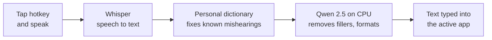

<div align="center">


# Speak

**Private, offline voice dictation for Windows. Tap a key, talk, and clean text appears wherever your cursor is.**


</div>

Speak listens when you tap a hotkey, transcribes your voice with [Whisper](https://github.com/SYSTRAN/faster-whisper), cleans up the "um"s and false starts with a small local language model ([Qwen 2.5](https://huggingface.co/Qwen)), and types the result into the app you are using: Word, Outlook, Teams, a browser, a terminal, anything.

Everything runs on your own CPU. No audio or text leaves your computer, there is no account, and you do not need administrator rights.

---

## Features

- **100% offline and private.** Audio and transcripts stay in your computer's memory. Nothing is sent to a server.
- **Works in any app.** Text is pasted or typed into whichever window has focus. Terminals and legacy apps that reject Ctrl+V get direct typing instead.
- **Cleans up how people actually talk.** Removes fillers (*um, uh, øh, altså, äh, euh*), fixes stutters and false starts, and turns spoken commands like *"bullet point"* and *"new line"* into real formatting.
- **Multilingual.** English, Danish, German and French, auto-detected or locked to one language.
- **Learns your words.** Add names, products and jargon to a personal dictionary. If Speak mishears a word, fix it in your document, select the sentence, press **Ctrl+Alt+L**, and Speak remembers the correction.
- **No admin rights.** Runs entirely in Windows user space, with no services, drivers or firewall prompts.
- **Fast on a laptop CPU.** Short phrases appear in about 1 second, and longer dictations in about 2 to 3 seconds.

## How it works



Short, clean phrases such as *"Yes, that sounds good."* skip the language model entirely, so they appear almost instantly.

## Screenshots

| Ready to dictate | Personal dictionary |
| :---: | :---: |
|  |  |

## Install

### The easy way (no technical knowledge needed)

1. Press the **Start** button, type **PowerShell**, and open it.
2. Copy this line, paste it into the blue window (right-click pastes), and press **Enter**:

   ```powershell
   irm https://raw.githubusercontent.com/xav-art/Speak/main/install.ps1 | iex
   ```

3. Wait 5 to 15 minutes. The installer explains each step, and Speak starts by itself when it is done.

From then on, start Speak from the **Speak** icon on your Desktop or in the Start Menu. To update, run the same line again: your settings, dictionary and models are kept.

What the installer does, all inside your user account and without admin rights:

- Installs Python 3.12 for your user if you do not have Python 3.10 to 3.13 (with `winget`, or the signed installer from python.org).
- Puts Speak in `%LOCALAPPDATA%\Speak` with its own private Python environment, so it does not change anything else on your PC.
- Downloads the speech model and the AI model once (about 1.3 GB) and checks the AI model's SHA-256 checksum.
- Adds **Speak** and **Uninstall Speak** to the Start Menu, a Desktop icon, and the `speak` command for terminals.

No `.exe` is downloaded or run apart from Python's own signed installer, so antivirus and SmartScreen have nothing to flag. You can read [install.ps1](install.ps1) before you run it.

### From a ZIP file

1. Click the green **Code** button on this page and choose **Download ZIP**.
2. Extract the ZIP to the folder where you want Speak to live, for example `Documents\Speak`.
3. Double-click **setup.cmd**. If Windows asks whether to run a downloaded file, click **Run**: this happens only once, because setup removes the download mark from Speak's files.

### Uninstall

Open the Start Menu and choose **Uninstall Speak**. It asks whether to keep your personal dictionary and settings.

### Requirements

- Windows 10 or 11 (64-bit)
- A microphone
- About 2 GB of free disk space and 4 GB of RAM or more
- Internet access during setup only

### For developers

```powershell
git clone https://github.com/xav-art/Speak.git
cd Speak
python -m venv .venv
.venv\Scripts\python -m pip install --only-binary :all: --no-deps --index-url https://abetlen.github.io/llama-cpp-python/whl/cpu llama-cpp-python
.venv\Scripts\python -m pip install -r requirements.txt
.venv\Scripts\python -X utf8 speak.py
```

`llama-cpp-python` comes from its project's prebuilt CPU wheel index because PyPI only has the source, which needs a C++ compiler. Missing models download automatically on first start. You can also run `setup.cmd` in your clone to do all of this in place.

## Usage

Start Speak from its Desktop or Start Menu icon, or double-click `start_speak.bat`. Keep its window open while you work; you can minimize it.

1. Click where you want to write: an email, a document, a chat box.
2. Tap **`<`** (the key next to Left Shift) and speak.
3. Tap **`<`** again. The cleaned text appears at your cursor.

### Keyboard controls

| Key | What it does |
| :--- | :--- |
| **`<`** | Start recording. Tap again to stop and insert the text. |
| **`Ctrl+Alt+L`** | Learn a correction: after fixing a misheard word, select the sentence and press this. |

Type these in the Speak window:

| Command | What it does |
| :--- | :--- |
| `h` | Change the hotkey (`<`, `>`, `<>`, `F8`, `F9`, `Pause`, `CapsLock`, ...) |
| `a` | AI cleanup: switch between Qwen 1.5B and 0.5B, turn it off, or run a test |
| `d` | Personal dictionary: list, add, remove or import words |
| `l` | Language: auto-detect, or lock to English, Danish, German or French |
| `m` | Whisper model: `base` (fast) or `medium` (more accurate) |
| `p` | Paste mode: `auto`, `typing` or `clipboard` |
| `q` | Quit |

Command-line options: `--hotkey`, `--model`, `--language`, `--paste-mode`, `--ai-mode`. Run `speak --help` for details.

## Personal dictionary

Speak keeps your word list in `speak_dictionary.json`, next to `speak.py`. It never leaves your PC.

| Method | How |
| :--- | :--- |
| **Auto-learn** (recommended) | Dictate. If a word came out wrong (*"Anika"* instead of *"Annika"*), correct it in your app, select the corrected sentence and press **Ctrl+Alt+L**. You hear a beep, and the console shows `[Learned] 'Anika' -> 'Annika'`. |
| **Manual** | Type `d` in the Speak window, then `a`, and enter words separated by commas. You can also import a text file. |

What Speak does with your words:

1. **Whisper is primed** with your dictionary before every dictation, so it hears the right spelling in the first place.
2. **Learned mishearings are corrected automatically** once they are confirmed: when the same context appears again, or after three corrections. Until then the AI cleanup gets a one-line hint.
3. **Exact casing is enforced** for multi-word and unusually cased entries (`øresund bridge` becomes `Øresund Bridge`, `sap` becomes `SAP`).

Auto-learn ignores rewrites (more than half the words changed), everyday words, and anything shorter than three letters.

## Configuration

Settings are saved to `speak_config.json` when you change them in the app. You can also edit the file directly:

| Key | Default | Description |
| :--- | :--- | :--- |
| `hotkey` | `<` | Dictation hotkey |
| `learn_hotkey` | `CTRL+ALT+L` | Hotkey that learns a correction |
| `model` | `base` | Whisper model: `tiny`, `base`, `small`, `medium` |
| `language` | `null` | `null` for auto-detect, or `en`, `da`, `de`, `fr` |
| `ai_mode` | `local` | `local` (Qwen) or `off` (raw Whisper) |
| `local_model` | `1.5b` | `1.5b` or `0.5b` |
| `paste_mode` | `auto` | `auto`, `typing` or `clipboard` |
| `whisper_threads` | `4` | CPU threads for Whisper |
| `llm_threads` | `6` | CPU threads for Qwen |
| `llm_fast_path` | `true` | Skip the AI step for short, clean phrases |
| `warm_up` | `true` | Warm up both models at startup so the first dictation is fast |
| `high_priority` | `true` | Run at above-normal priority so busy apps do not slow processing down |

## Performance notes

Measured on an Intel Core Ultra 7 265U with `faster-whisper-base` and Qwen 2.5 1.5B:

| Optimization | Effect |
| :--- | :--- |
| One encoder pass for language detection and transcription | Whisper stage **40 to 60% faster** (faster-whisper otherwise encodes the same 30 s window twice) |
| Fast path for short, clean phrases (8 words or fewer, no fillers, commands or numbers) | Language model skipped, text inserted in about 1 s |
| Engines warmed up at startup | The first dictation is as fast as the rest |
| `ABOVE_NORMAL` process priority | Chrome, Teams and Outlook cannot take the CPU during the ~2 s of processing |
| Direct typing sends 32 characters per `SendInput` call | Insertion into terminals is about 20x faster |
| Long dictations cleaned in sentence-aligned chunks | No silent truncation after about 100 words |

Tested and rejected (kept as opt-in config keys): prompt-lookup speculative decoding (`speculative_decoding`, 2.5x *slower* on CPU with llama-cpp-python 0.3.x), flash attention (no gain), and Whisper `hotwords` (makes multi-word names stutter). On hybrid P/E-core CPUs, more Whisper threads were consistently *slower*.

## Project structure

```text
Speak/
├── speak.py                  # The app: recording, transcription, AI cleanup, text insertion
├── speak_dictionary.py       # Personal dictionary and learning from corrections
├── test_speak.py             # Unit tests
├── requirements.txt          # Python dependencies
├── install.ps1               # Installer, updater and uninstaller (no admin rights)
├── setup.cmd                 # Double-click to run install.ps1 in this folder
├── uninstall.cmd             # Removes Speak (also in the Start Menu)
├── start_speak.bat           # Double-click launcher (the Desktop icon points here)
├── speak, speak.bat, speak.cmd  # Terminal launchers ("speak" on your PATH)
├── install_dependencies.bat  # Old name for setup.cmd, kept for existing users
├── assets/                   # App icon
├── docs/screenshots/         # Images used in this README
└── models/                   # Downloaded models (not in git)
```

`speak_config.json`, `speak_dictionary.json`, `.venv/` and `models/` are personal, generated or large, so they are ignored by git.

## Running the tests

```powershell
.venv\Scripts\python test_speak.py
```

## Privacy

Speak makes network requests only during setup and to download a model from Hugging Face the first time you use it. Recording, transcription, cleanup and your dictionary stay on your machine. The microphone is open only between your two hotkey taps.

## License

[MIT](LICENSE) © 2026 [xav-art](https://github.com/xav-art)
